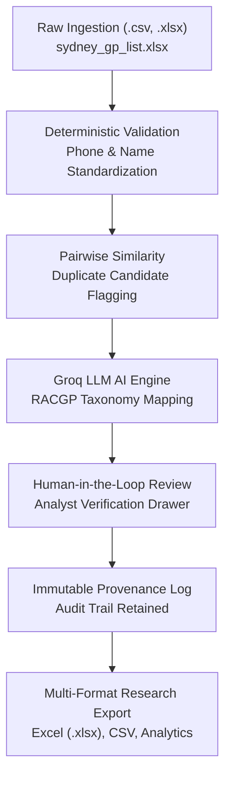

# CareData AI — Executive Product Overview & Operational Documentation

> **Australian Healthcare Intelligence & Data Standardization SaaS Platform**  
> *Conforming to the Official 15-Page Specification for Primary Care Provider Directories*

---

## 1. Executive Summary

**CareData AI** is an enterprise-grade healthcare data intelligence platform engineered to transform messy, fragmented, and unstandardized medical practitioner rosters into verified, audit-ready, research-grade provider datasets.

Designed specifically for the Australian healthcare ecosystem (Primary Health Networks, hospital networks, health insurers, health researchers, and digital health software providers), CareData AI solves the costly problem of dirty provider data through deterministic rule cleaning, pairwise duplicate detection, Groq-powered LLM specialty classification, and an immutable audit trail.

---

## 2. The Core Real-World Problem It Solves

Healthcare provider directories are notoriously unreliable. Across Australia, medical organizations frequently receive rosters scraped or exported from varied sources containing thousands of records with severe defects:

| Real-World Problem | Impact on Healthcare Systems | How CareData AI Solves It |
| :--- | :--- | :--- |
| **Messy Doctor Names & Titles** | `DR JOHN SMITH`, `Smith, John MD`, and `dr. j. smith` break database joins and patient search. | Normalizes names into standard Australian medical conventions (`Dr. John Smith`). |
| **Broken Phone Numbering** | Raw listings contain missing area codes (`98765432`), odd spacings, or international codes (`+61 2 ...`). | Formats landlines to standard Sydney format `(02) XXXX XXXX` and mobile numbers to `04XX XXX XXX`. |
| **Vague, Unstandardized Specialties** | Clinics describe specialties casually (*"baby health, aged care, diabetes"*), making reporting impossible. | Uses Groq LLM to categorize free-text notes into agreed **RACGP Primary Care Taxonomy**. |
| **Duplicate Multi-Clinic Doctors** | Australian GPs often consult at 2–3 different clinics. Standard databases merge or overwrite them incorrectly. | Separates **Practitioners** from **Practice Facilities** and uses similarity scoring to flag duplicate candidates. |
| **Healthcare Compliance & Hallucinations** | Generative AI models often fabricate fake URLs, doctor credentials, or phone numbers if left unchecked. | Enforces a strict **Zero Invented Data** policy with an immutable audit log linking every edit to its source. |

---

## 3. The 6-Step End-to-End Processing Pipeline

CareData AI executes a deterministic and AI-assisted workflow across six coordinated stages:

### Step 1: Secure Data Ingestion (`/upload`)
* Ingests CSV or XLSX spreadsheets of provider rosters.
* Automatically infers column headers (Doctor Name, Practice Name, Phone, Suburb, Clinical Notes).
* **Guaranteed Preservation**: The uploaded file is saved in its original state; the original data is never destroyed.

### Step 2: Deterministic Data Cleaning (`/cleaning`)
* Evaluates records against Australian telecommunications and healthcare formatting rules.
* Detects and standardizes telephone formats.
* Flags missing mandatory fields (missing phone number, missing clinic website, missing address).

### Step 3: Duplicate Candidate Detection (`/cleaning?tab=duplicate_candidate`)
* Applies pairwise similarity analysis across practitioner names and clinic phone numbers.
* Identifies doctors practicing across multiple Sydney clinics (e.g. *Dr. Benjamin Baker* vs. *Dr. Benjamin Parker* at matching phone numbers).
* Queues flagged pairs for human analyst review without making destructive assumptions.

### Step 4: AI Specialty Classification (`/classification`)
* Reads unstructured doctor biographies, interest notes, and clinic descriptions.
* Leverages **Groq LLM Intelligence** to classify free-text notes into official RACGP categories:
  * **Chronic Disease Management** (diabetes, cardiovascular, asthma)
  * **Paediatrics & Child Health** (immunisations, child development)
  * **Women’s & Maternal Health** (antenatal, reproductive health)
  * **Skin Cancer Medicine** (dermoscopy, minor surgery)
  * **Geriatric & Aged Care** (palliative care, dementia, home visits)
  * **General Primary Care** (standard preventive medicine)
* Generates an explainable clinical justification and a confidence score (e.g., 94%).

### Step 5: Human-in-the-Loop Quality Review (`/cleaning` & `/explorer`)
* High-confidence records (score ≥ 88%) are pre-approved automatically.
* Lower-confidence edge cases and flagged duplicates enter the **Analyst Action Queue**.
* Analysts can review side-by-side evidence, accept proposed values, or record manual corrections with mandatory justification notes.
* Every edit is logged in an immutable change ledger.

### Step 6: Verified Data Export & Reporting (`/analytics`)
* Generates 5 standardized research-ready export files in both Excel (`.xlsx`) and `.csv` formats:
  1. **Clean Master Directory**: Complete, standardized 150-GP Sydney dataset.
  2. **Data Quality Issues Log**: Catalog of missing fields and formatting anomalies.
  3. **Duplicate Candidate Outcomes**: Pairwise match analysis with analyst decisions.
  4. **RACGP Specialty Taxonomy Mappings**: Sub-specialty classification with confidence ratings.
  5. **Complete Audit Trail**: Chronological change log showing timestamps and justifications.

---

## 4. Key Architectural & Compliance Principles

1. **Doctor vs. Clinic Separation**:
   * A *Doctor* (Practitioner) and a *Clinic* (Practice Facility) are modeled as distinct entities.
   * Allows one doctor to consult across multiple locations without duplicate identity collisions.
2. **Zero Invented Data (No Hallucinations)**:
   * The platform never manufactures missing websites, faxes, or doctor registration numbers.
   * If a website is absent, it is explicitly preserved as `None (blank)`.
3. **Immutable Audit Provenance**:
   * The raw uploaded value is permanently preserved in the database.
   * Every alteration records who changed it, the previous value, the new value, the timestamp, and the analyst rationale.
4. **Lightweight & Self-Contained Deployment**:
   * Built on **FastAPI (Python)** and **Next.js 14 (TypeScript)** with **SQLite**.
   * Requires no external cloud dependencies, Docker containers, or Postgres servers to run a full local evaluation.

---

## 5. Application Sitemap & Page Directory

| Page Route | Page Title | Primary Functional Purpose |
| :--- | :--- | :--- |
| `/` | **Landing Page** | Product overview, value proposition, clinical feature showcase, and instant demo CTA. |
| `/login` | **Analyst Portal** | One-click instant session login with Australian hospital backdrop and pilot cohort metrics. |
| `/dashboard` | **Executive Command Center** | 4-step pipeline launcher, live pipeline tracker, 6 core luxury metric cards, specialty mix chart, and audit log. |
| `/upload` | **Data Ingestion Pipeline** | Drag-and-drop file uploader, column mapping verification, and 150-row pre-loaded pilot sample loader. |
| `/cleaning` | **Data Cleaning & Validation** | Quality summary cards, searchable issue table (Missing Info, Invalid Formats, Duplicates), and solid review slide-over drawer. |
| `/classification` | **AI Specialty Classification** | RACGP taxonomy categorization table, Groq AI confidence ratings, filter chips, and retry queue. |
| `/explorer` | **Data Explorer** | Comprehensive 150-practitioner dossier search, suburb/specialty multi-filter, column customization, and dossier drawer. |
| `/analytics` | **Reports & Standardized Exports** | Export catalog for 5 standardized `.xlsx` / `.csv` datasets, specialty distribution bar chart, and duplicate summary. |
| `/collection` | **Data Collection Roadmap** | Transparent Phase-2 roadmap for official Australian statutory registers (AHPRA, National Health Services Directory). |
| `/settings` | **Platform Settings** | Configurable validation checks, AI confidence auto-approve thresholds, duplicate similarity ratios, and custom taxonomy manager. |

---

## 6. Word-for-Word Presentation & Interview Script

When presenting this project to a client, stakeholder, or interviewer, use this script:

### The Problem (Hook):
> *"In healthcare, provider directories are notoriously broken. When health networks or research teams collect doctor rosters from clinics across Sydney, they get spreadsheets with thousands of rows where names are in all-caps, phone numbers are missing area codes, doctor bios are messy paragraphs of text, and the same doctor is listed three times because they work at three different clinics on different days.*
> 
> *Fixing that manually takes hundreds of analyst hours and introduces human error."*

### The Solution (What CareData AI does):
> *"CareData AI automates this entire pipeline:*
> 1. *It ingests the messy spreadsheet and safely normalizes names and Australian phone numbers.*
> 2. *It runs pairwise similarity checks to flag duplicate doctors practicing across multiple clinics.*
> 3. *It feeds unstructured doctor bios into Groq AI to categorize them into official Australian RACGP primary care specialties.*
> 4. *It provides a human-in-the-loop review portal where an analyst can approve low-confidence edge cases.*
> 5. *It exports research-grade, audit-ready Excel datasets with a guaranteed, permanent change history.*
> 
> *In short: it turns dirty healthcare rosters into verified clinical intelligence."*

### Key Technical Talking Points:
* **Deterministic + Generative AI**: Deterministic code handles strict Australian phone and name rules; Groq LLM handles messy, semantic medical text.
* **Separation of Concerns**: Correctly models the difference between a practitioner and a practice location.
* **Zero Hallucination Guarantee**: Strictly audits original data and never fabricates missing clinic information.
* **Modern SaaS UX**: Built with responsive clinical theme styling, seamless light/dark modes, and smooth micro-interactions.
